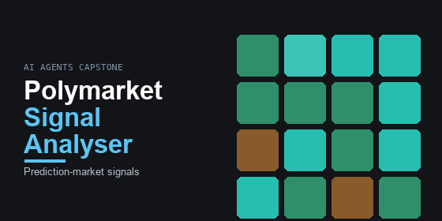

# My Financial Scanner

*(repo: polymarket-signal-analyser — it started as a Polymarket signal scanner)*



An agentic pipeline that scans [Polymarket](https://polymarket.com) prediction
markets, scores each one 0–10 for relevance to **your** equity watchlist with an
LLM, stores everything in Postgres (Supabase), writes a daily analyst brief, and
serves it all through a dashboard with a tool-calling analyst agent.

Built for the Google × Kaggle AI Agents Intensive capstone (Agents for Business).

**[▶ Live demo](https://polymarket-signal-analyser.streamlit.app/) · [📹 Video walkthrough](https://youtu.be/bJJFs-PAE8k)**

## What it does

```
Polymarket Gamma API ─(hourly)→ markets ─→ LLM filter (0-10 + tickers + reasoning) ─→ signals
                                                        │
             dashboard ← analyst agent (tool loop) ← ───┤── → nightly brief
                              │
                        MCP server (same tools, open protocol)
```

## Configure your watchlist

The watch universe lives in [watchlist.json](watchlist.json) and is editable in
the dashboard sidebar — tickers with one-line descriptions, plus focus sectors.
Every prompt (filter, news, brief, agent) is built from it at call time, so new
scans immediately score against your book. Ships with an example set
(NVDA, TSLA, COIN, LLY).

## Setup

1. `pip install -r requirements.txt`
2. Create a [Supabase](https://supabase.com) project, paste [schema.sql](schema.sql)
   into the SQL editor, run it.
3. Copy `.env.example` → `.env`, fill in `SUPABASE_URL`, `SUPABASE_KEY`,
   `OPENAI_API_KEY`.

## Usage

```bash
python3 -m src.scheduler --once     # one full pass: fetch → filter → report
python3 -m src.scheduler            # hourly scans + nightly brief
uvicorn server:app --reload         # the web app (FastAPI + hand-built front end in web/)
streamlit run app.py                # the original Streamlit dashboard (legacy)
python3 -m src.mcp_server           # expose the tools over MCP (stdio)
python3 tests/eval_filter.py        # eval the filter against the labeled set
```

## Screener and portfolio

- **Screener** ([src/market.py](src/market.py), universe in [universe.json](universe.json)): ~30 European UCITS ETFs and ~50 large
  European/US stocks, 5 years of end-of-day prices from Yahoo Finance, all converted to EUR. Ranked 0–100 on return for the
  risk, growth per year, worst fall and the last 12 months; every number comes with a plain-English sentence and a €1,000
  example, and an optional AI write-up explains any instrument for a beginner.
- **Portfolio** ([src/portfolio.py](src/portfolio.py)): add trades or import a broker CSV (English or German headers, `14.03.2025`
  dates, `1.234,56` numbers). Average-cost positions, P&L, how today's mix would have behaved, and plain-English notes on
  concentration and overlap. **Private by design:** trades live in `data/trades.json` (gitignored) and the API refuses
  portfolio requests that don't come straight from localhost, so a hosted copy can never expose them.
- Not investment advice: it ranks and explains; it never tells you to buy or sell, and it never places trades.

## The web app

`server.py` is a thin FastAPI layer over the same modules the scanner uses; the UI in [web/](web/) is plain
HTML/CSS/JS with no build step. Views: **Overview** (hottest segment, hot-topics ranking, heatmap, watchlist
exposure, catalysts), **Signals** (search, sector/ticker chips and sorting, all synced to the URL), **News**,
**Ask** (the tool-calling agent) and **Brief**. Ranking logic lives in [src/views.py](src/views.py) and is unit-tested.
Deploy with [render.yaml](render.yaml) (set `SUPABASE_URL`, `SUPABASE_KEY`, `OPENAI_API_KEY` in the dashboard). The
write endpoints that spend OpenAI budget are rate-limited per IP.

## Agentic design (course concepts)

- **Tool-calling agent** ([src/agent.py](src/agent.py)) — plans and chains
  `query_signals` / `portfolio_exposure` / `get_latest_brief`; the UI shows the
  tool trace.
- **MCP server** ([src/mcp_server.py](src/mcp_server.py)) — the same tools over
  the Model Context Protocol; config snippet for Claude Desktop in the docstring.
- **Security** — sports/entertainment markets are hard-zeroed by regex *before*
  any LLM call; `affected_tickers` is validated against the watchlist (the model
  once invented a ticker); the agent loop has a hard tool-call budget.
- **Evals** ([tests/eval_filter.py](tests/eval_filter.py)) — 14 labeled markets
  with expected score bands as a regression gate on prompt changes.

## Notes

- Polymarket's Gamma API caps each request at 100 markets; ingestion pages by
  offset, dedupes overlapping pages, and drops already-resolved markets.
- All reads go through one clean path (`database.get_signals`) that dedupes and
  drops expired markets — dashboard, brief, and agent see the same data.
- The LLM *is* the filter — no brittle keyword pre-filter. The sports guard skips ~25% of calls.
- **Models** are chosen in one place, [src/llm.py](src/llm.py): `gpt-6.1-sol` scores markets (one call per
  market; `gpt-6-luna` is the cents-per-scan option) and `gpt-6-astra` powers the agent, brief, news read-through and ticker suggestions. Override with
  `SCORE_MODEL` / `SMART_MODEL` and `*_EFFORT`. If a model is
  unavailable to your key the call degrades to `gpt-4o-mini` instead of failing; `python -m src.llm` shows what
  answers. Re-run `python3 tests/eval_filter.py` after changing the scoring model — it is the regression gate.
- Retrieval is a keyword-ranked pull, deliberately not a vector store — swap in
  pgvector if the signal table grows past ~5k rows.
